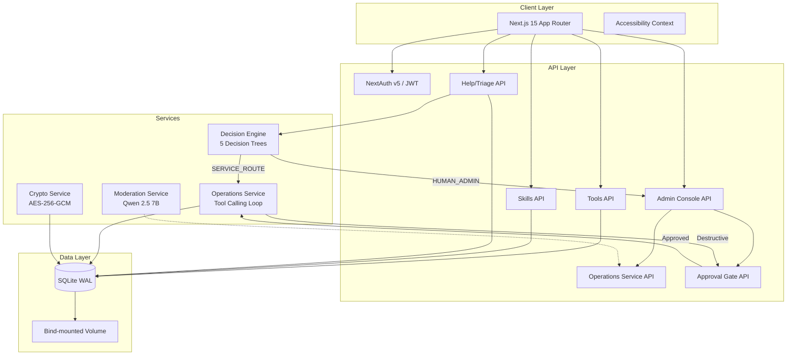
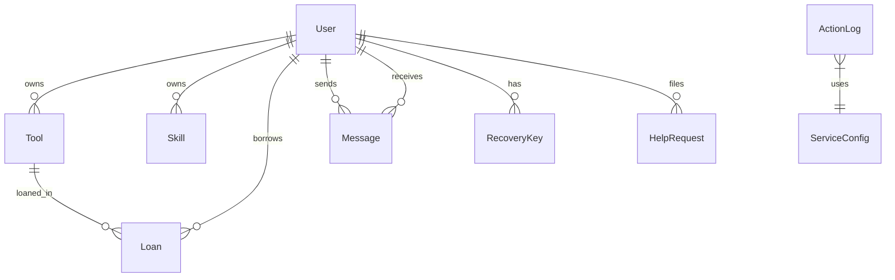

# Tool Library Wiki

> **Complete documentation for the Tool Library v2 codebase** — a zero-PII, self-hosted community tool lending and skills exchange platform built with Next.js 15, Prisma/SQLite, and an automated operations service with human approval gates.

[](https://nextjs.org/)
[](https://typescriptlang.org/)
[](https://prisma.io/)
[](https://tailwindcss.com/)
[](https://podman.io/)
[](LICENSE)
[](#-zero-pii-commitment)

---

## 🎯 Project Vision

The Tool Library is a **privacy-first, community-operated platform** for neighbor-to-neighbor tool lending and skill sharing. Designed for communities that value data sovereignty, it runs entirely on your hardware with zero external dependencies, zero tracking, and zero personally identifiable information.

### Why This Exists

| Problem | Our Approach |
|---------|--------------|
| Tool libraries require signups with email/phone | **Zero PII** — only a username and public alias |
| Cloud platforms harvest usage data | **Local-first** — single SQLite file on your volume |
| "Smart" features send data to third parties | **Human approval gates** — no autonomous destructive actions |
| Complex deployments need Kubernetes | **Single binary** — rootless Podman on Fedora CoreOS |

---

## 📖 Documentation Index

| # | Page | Description | Est. Read |
|---|------|-------------|-----------|
| **00** | [Project Overview](00-Project-Overview.md) | Mission, tech stack, principles, repo structure, key flows | 5 min |
| **01** | [Architecture & Data Models](01-Architecture-Data-Models.md) | Prisma schema, ERD, all 8 models, indexes, enums | 10 min |
| **02** | [Authentication & Authorization](02-Auth-Authorization.md) | NextAuth v5, JWT sessions, route protection, registration, recovery | 8 min |
| **03** | [Core Features: Tools, Skills, Loans](03-Core-Features.md) | Tool catalog, skills exchange, loan lifecycle, search/filter, trust scores | 8 min |
| **04** | [Help System & Triage](04-Help-System-Triage.md) | Decision engine classifier (5 trees), routing logic, service dispatch | 10 min |
| **05** | [Operations Service & Approval Gates](05-Operations-Service-Approval-Gates.md) | Operation registry, approval gate interceptor, turn loop, admin confirmation | 12 min |
| **06** | [Admin Console](06-Admin-Console.md) | Terminal UI: telemetry, service config, ops console, approval queue, help queue, moderation audits, governance | 10 min |
| **07** | [Deployment & Operations](07-Deployment-Operations.md) | Rootless Podman on FCOS, Containerfile, deploy.sh, maintenance, backups | 10 min |
| **08** | [Security & Privacy](08-Security-Privacy.md) | Zero-PII, encrypted secrets, approval gates, validation, access control, audit trail, hardening | 10 min |

---

## 🏗️ System Architecture



### Core Design Principles

| Principle | Implementation |
|-----------|----------------|
| **Zero PII** | No emails, phones, IPs, locations — only `username` + public `alias` |
| **Local-first** | Single SQLite file on bind-mounted volume; no external DB |
| **Human-in-the-loop** | Destructive operations *always* require explicit admin approval |
| **Audit everything** | Every operation call persisted with outcome to `ActionLog` |
| **Accessibility by default** | WCAG 2.1 AA contrast, dyslexic font, reduced motion, reading guide |
| **No telemetry** | `NEXT_TELEMETRY_DISABLED=1`, no analytics, no request/IP logging |

---

## 🚀 Quick Start

### Local Development

```bash
# 1. Clone and enter
git clone <repository-url> toolslibrary-v2
cd toolslibrary-v2

# 2. Configure environment
cp .env.example .env
# Edit .env: set DATABASE_URL="file:./data/tool_library.db" and AUTH_SECRET

# 3. Install & initialize
npm install
npx prisma db push

# 4. Run development server
npm run dev
# → http://localhost:3000
```

### Production Deployment (Fedora CoreOS + Rootless Podman)

```bash
# On FCOS host
git clone <repository-url> /var/home/core/srv/tool-library
cd /var/home/core/srv/tool-library

# Optional: pin secrets across redeploys
export AUTH_SECRET="$(openssl rand -hex 32)"
export SERVICE_ENCRYPTION_KEY="$(openssl rand -hex 32)"

# Deploy (idempotent)
./deploy.sh

# Verify
podman ps
curl -s http://localhost:3000
podman healthcheck run tool-library
```

**First admin:** The first account registered on an empty database automatically receives the `ADMIN` role.

---

## 🔑 Key Concepts

| Concept | Summary | Deep Dive |
|---------|---------|-----------|
| **Zero-PII** | No emails, phones, IPs — only `username` + public `alias` | [00-Overview](00-Project-Overview.md), [08-Security](08-Security-Privacy.md) |
| **Approval Gate** | Destructive operations → `PENDING` → Admin approval required | [05-Operations](05-Operations-Service-Approval-Gates.md) |
| **Decision Engine** | 5 weighted decision trees vote on help request routing | [04-Triage](04-Help-System-Triage.md) |
| **Trust Score** | Base 100, displayed as `vouch = score - 100` (±N) | [03-Features](03-Core-Features.md) |
| **Standalone Build** | `output: 'standalone'` for minimal container footprint | [07-Deployment](07-Deployment-Operations.md) |
| **SQLite WAL** | Single-file DB, `PRAGMA journal_mode=WAL`, bind-mounted | [01-Architecture](01-Architecture-Data-Models.md) |

---

## 🛠️ Development Commands

```bash
# ─── Type Safety ───
npm run typecheck          # tsc --noEmit (strict mode)

# ─── Build ───
npm run build              # prisma generate + next build

# ─── Runtime ───
npm run dev                # Development server with HMR
npm run start              # Production server (requires build first)

# ─── Database ───
npx prisma studio          # Visual database browser
npx prisma db push         # Sync schema (dev)
npx prisma migrate dev     # Create migration (dev)
npx prisma generate        # Regenerate client

# ─── Quality Gates ───
node scripts/verify-handoff.mjs  # CI gate: checksum verification
```

---

## 📁 Repository Structure (Annotated)

```
toolslibrary-v2/
├── prisma/
│   └── schema.prisma          # ← Single source of truth for all data models
├── src/
│   ├── app/                   # Next.js 15 App Router
│   │   ├── api/
│   │   │   ├── agent/         # Operations chat + approval confirmation
│   │   │   ├── llm/           # Service configuration (encrypted at rest)
│   │   │   └── messages/      # Direct messaging between members
│   │   ├── admin/             # Admin Command Console (terminal aesthetic)
│   │   ├── tools/             # Tool catalog, detail, create
│   │   ├── skills/            # Skills exchange, detail, create
│   │   ├── help/              # Public triage intake
│   │   ├── dashboard/         # Member dashboard
│   │   └── (auth pages)       # login, register, change-password, recover
│   ├── components/
│   │   ├── a11y/              # AccessibilityMenu, ReadingGuide
│   │   ├── layout/            # Navbar, Footer
│   │   └── messenger/         # MessengerWidget (DMs)
│   ├── context/
│   │   └── AccessibilityContext.tsx  # Cross-session a11y prefs
│   ├── lib/
│   │   ├── actions/           # Server Actions (auth, help, admin, messages)
│   │   ├── operations/        # tools.ts (registry + safety), run.ts (turn loop)
│   │   ├── services/
│   │   │   ├── triage.ts      # Decision engine (5 trees, weighted vote)
│   │   │   ├── llm.ts         # Provider resolution, chatCompletion
│   │   │   └── admin-ai.ts    # Moderation audits (Qwen 2.5 7B)
│   │   ├── crypto.ts          # AES-256-GCM, recovery code hashing
│   │   ├── db.ts              # Prisma singleton (WAL pragmas)
│   │   └── constants.ts       # CATEGORIES, SKILL_CATEGORIES
│   ├── auth.config.ts         # NextAuth config + callbacks
│   └── middleware.ts          # Force password change, route protection
├── Containerfile              # Multi-stage rootless Podman image
├── deploy.sh                  # Idempotent FCOS deployment wrapper
├── .dockerignore              # Excludes secrets, runtime data, build artifacts
├── next.config.ts             # output: 'standalone'
├── package.json
├── tsconfig.json
├── DEPLOYMENT.md
├── CLEANUP_REPORT.md
└── AGENTS.md                  # Operating contract for automated agents
```

---

## 🗄️ Data Model Overview



### Core Entities

| Entity | Purpose | Key Fields |
|--------|---------|------------|
| **User** | Community member | `username`, `alias`, `role`, `trustScore`, `banned` |
| **Tool** | Lendable item | `name`, `category`, `status` (AVAILABLE/BORROWED/MAINTENANCE) |
| **Skill** | Offered expertise | `name`, `category`, `available` (OFFERED/PAUSED) |
| **Loan** | Borrowing lifecycle | `status`, `startDate`, `endDate`, `returnCondition` |
| **HelpRequest** | Support ticket | `category`, `urgency`, `route`, `status` |
| **ServiceConfig** | Operations service config | `provider`, `model`, `apiKeyEnc` (AES-256-GCM) |
| **ActionLog** | Audit trail + approval gate | `toolName`, `destructive`, `status` (PENDING/EXECUTED/REJECTED) |

---

## 🛡️ Security Highlights

| Layer | Mechanism |
|-------|-----------|
| **Auth** | bcrypt cost 12, JWT HS256, 1h sliding expiry, CSRF protection |
| **Secrets** | AES-256-GCM at rest, scrypt-derived master key, never returned to client |
| **Operations** | Approval gate: destructive ops → `PENDING` → Admin confirm → execute |
| **Validation** | Zod schemas on all inputs (API, forms, operation args, service output) |
| **Container** | Rootless Podman, `--userns=keep-id`, SELinux `:Z`, non-root user |
| **Audit** | Every operation call logged to `ActionLog` with args/result/error |

---

## 🧪 Quality Assurance

- **Zero-stub tolerance**: No `TODO`, `FIXME`, or `throw "Not implemented"` in `src/`
- **Strict TypeScript**: `tsc --noEmit` passes with no errors
- **Schema-driven**: Prisma as single source of truth; Zod mirrors for runtime validation
- **Checksum verification**: `verify-handoff.mjs` ensures repo integrity across sessions
- **No external deps at runtime**: All code bundles into standalone binary

---

## 🔗 External References

| Technology | Documentation |
|------------|---------------|
| Next.js 15 | <https://nextjs.org/docs> |
| Prisma 5 | <https://www.prisma.io/docs> |
| NextAuth v5 | <https://authjs.dev> |
| Tailwind CSS v4 | <https://tailwindcss.com> |
| Zod | <https://zod.dev> |
| Podman Rootless | <https://rootlesscontaine.rs/getting-started/podman/> |
| Fedora CoreOS | <https://fedoraproject.org/coreos/> |
| SQLite WAL Mode | <https://sqlite.org/wal.html> |

---

## 🤝 Contributing

See [`CONTRIBUTING.md`](../toolslibrary-v2/CONTRIBUTING.md) if available, otherwise:

1. **Fork → Branch → PR** with descriptive title
2. **TypeScript strict mode** — no `any`, no implicit returns
3. **Zod validation** on all inputs (API routes, Server Actions, operation args)
4. **Zero-stub tolerance** — no `TODO`, `FIXME`, placeholder implementations
5. **Update relevant wiki page(s)** — documentation lives in `../wiki/`
6. **Run quality gates** — `npm run typecheck`, `npm run build`, `node scripts/verify-handoff.mjs`

---

## 📄 License

**AGPL-3.0-only** — see `Containerfile` OCI labels and repository root.

This license ensures that if you modify and deploy this software as a network service, you must offer the corresponding source code to your users. It protects the community's right to self-host and audit the platform they depend on.

---

## 📊 Documentation Statistics

| Metric | Count |
|--------|-------|
| Wiki pages | 9 |
| Total documentation | ~75 KB |
| Code files documented | 47 |
| Mermaid diagrams | 3 |
| Tables | 28 |
| Code blocks | 41 |

---

> **Generated from codebase analysis** — This wiki reflects the actual implementation in `toolslibrary-v2/` as of 2026. Run `node scripts/verify-handoff.mjs` to verify integrity.
