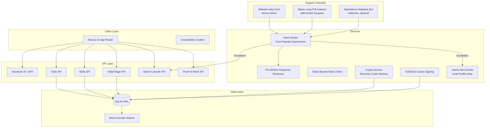
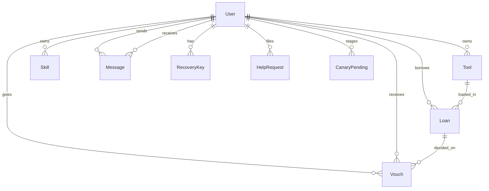

# ToolsLibrary
---

Documentation for the ToolsLibrary v2 codebase: a self-hosted, zero-PII platform for neighbor-to-neighbor tool lending and skills exchange. Built with Next.js 15, Prisma and SQLite, plus a strictly deterministic support and triage system — pure TypeScript and regular expressions with a fixed dictionary of pre-written replies. Unauthenticated write surfaces are protected by token-bucket rate limits and browser proof-of-work gates, and the warrant canary is signed with Ed25519.

[](https://nextjs.org/)
[](https://typescriptlang.org/)
[](https://prisma.io/)
[](https://tailwindcss.com/)
[](https://podman.io/)
[](wiki/Community%20&%20Guidelines/license.md)
[](#core-design-principles)
[](https://fedoraproject.org/coreos/)
[-0066cc?logo=w3c&logoColor=white)](https://www.w3.org/TR/WCAG22/)

---

## Project Vision

The ToolsLibrary is a community-operated platform for lending tools and trading skills. It runs on hardware you control, keeps everything in one SQLite file, and collects no personally identifiable information. There is no tracking, no analytics, and no third-party service in the request path.

### Why This Exists

| Problem | Our Approach |
|---------|--------------|
| Tool libraries usually require signups with email or phone | Zero PII: an account is a username and a public alias |
| Cloud platforms harvest usage data | Local-first: a single SQLite file on your volume |
| "Smart" features quietly send data to third parties | Deterministic support: every automated reply is a fixed, reviewed string selected by plain regular expressions |
| Complex deployments need Kubernetes | One container: rootless Podman on Fedora CoreOS |

---

## Documentation Index

The documentation source lives in [`wiki/`](wiki/) and is published to the self-hosted LeafWiki instance. The links below point at the files in this repository.

### Platform Overview

| Page | Description | Est. Read |
|------|-------------|-----------|
| [Project Overview](wiki/Platform%20Overview/project-overview.md) | Mission, tech stack, principles, repo structure, key flows | 5 min |
| [Core Features](wiki/Platform%20Overview/core-features.md) | Tool catalog, skills exchange, loan lifecycle, QR handoff, search/filter, trust scores | 8 min |

### System Architecture & Security

| Page | Description | Est. Read |
|------|-------------|-----------|
| [Architecture & Data Models](wiki/System%20Architecture%20&%20Security/architecture-and-data-models.md) | Prisma schema, ERD, all 11 models, indexes, enums, canary models | 10 min |
| [Authentication & Authorization](wiki/System%20Architecture%20&%20Security/authentication-and-authorization.md) | NextAuth v5, JWT sessions, route protection, registration, recovery, admin email setup | 8 min |
| [Security & Privacy](wiki/System%20Architecture%20&%20Security/security-and-privacy.md) | Zero-PII, rate limiting, proof of work, secrets handling, signed canary, validation, access control, hardening | 10 min |

### Platform Administration

| Page | Description | Est. Read |
|------|-------------|-----------|
| [Help System & Triage](wiki/Platform%20Administration/help-system-and-triage.md) | Regex intent router, pre-written responses, Matrix listener, webhook channel, escalation | 10 min |
| [Admin Console](wiki/Platform%20Administration/admin-console.md) | Terminal UI: telemetry, help queue, moderation, governance, warrant canary | 10 min |

### Infrastructure & Deployment

| Page | Description | Est. Read |
|------|-------------|-----------|
| [Deployment & Operations](wiki/Infrastructure%20&%20Deployment/deployment-and-operations.md) | Rootless Podman on FCOS, Containerfile, deploy.sh, migrations, backups, maintenance | 10 min |

### Community & Guidelines

| Page | Description | Est. Read |
|------|-------------|-----------|
| [Code of Conduct](wiki/Community%20&%20Guidelines/code-of-conduct.md) | Mutual aid, harassment policy, moderation accountability | 5 min |
| [Contributing](wiki/Community%20&%20Guidelines/contributing.md) | Dev environment, invariants, coding standards, quality gates | 8 min |
| [Privacy Policy](wiki/Community%20&%20Guidelines/privacy-policy.md) | The complete inventory of stored data | 5 min |
| [Terms of Service](wiki/Community%20&%20Guidelines/terms-of-service.md) | The community contract | 5 min |
| [Transparency Report](wiki/Community%20&%20Guidelines/transparency-report.md) | Warrant canary, third-party sharing, server facts | 5 min |
| [License](wiki/Community%20&%20Guidelines/license.md) | GNU AGPLv3, verbatim | — |

---

## System Architecture



### Core Design Principles

| Principle | Implementation |
|-----------|----------------|
| **Zero PII** | No emails, phones, IPs, or locations from members. An account is a `username` plus a public `alias`; the one exception is an optional notification email on operator accounts |
| **Local-first** | One SQLite file on a bind-mounted volume; no external database |
| **Deterministic support** | Replies come from a fixed, reviewed dictionary; routing is pure regex — no external services in the support path |
| **Abuse resistance** | Token-bucket rate limits and proof-of-work gates on every unauthenticated write surface |
| **Accessibility by default** | WCAG 2.2 AAA targets: contrast modes, dyslexia-friendly font, reduced motion, reading guide |
| **No telemetry** | `NEXT_TELEMETRY_DISABLED=1`, no analytics, no request or IP logging |

**Accessibility status:** features targeting WCAG 2.2 Level AAA are implemented where feasible, and some WCAG 3.0 draft criteria are adopted. Automated checkers only cover part of the standard, so full compliance is not claimed. A manual audit is recommended before production use.

---

## Quick Start

### Local Development

```bash
# 1. Clone and enter
git clone <repository-url> toolslibrary-v2
cd toolslibrary-v2

# 2. Configure environment
cp .env.example .env
# Edit .env: set DATABASE_URL="file:./data/tool_library.db" and AUTH_SECRET

# 3. Install & initialize
npm install
npx prisma db push

# 4. Run development server
npm run dev
# → http://localhost:3000
```

### Production Deployment (Fedora CoreOS + Rootless Podman)

```bash
# On FCOS host
git clone <repository-url> /var/home/core/srv/tool-library
cd /var/home/core/srv/tool-library

# Optional: pin secrets across redeploys
export AUTH_SECRET="$(openssl rand -hex 32)"

# Deploy (idempotent)
./deploy.sh

# Verify
podman ps
curl -s http://localhost:3000
podman healthcheck run tool-library
```

**First admin:** the first account registered on an empty database receives the `ADMIN` role automatically, and is locked to `/admin-email` until a notification email is on record.

---

## Key Concepts

| Concept | Summary | Deep Dive |
|---------|---------|-----------|
| **Zero-PII** | No emails, phones, or IPs from members. Only `username` and a public `alias` | [Project Overview](wiki/Platform%20Overview/project-overview.md), [Security & Privacy](wiki/System%20Architecture%20&%20Security/security-and-privacy.md) |
| **Intent router** | Priority-ordered regular expressions classify every help message | [Help System & Triage](wiki/Platform%20Administration/help-system-and-triage.md) |
| **Dual-channel support** | The website help form and the community Matrix server share one triage engine, with an optional standalone helpdesk bot in between | [Help System & Triage](wiki/Platform%20Administration/help-system-and-triage.md) |
| **Rate limiting + proof of work** | Token buckets and browser puzzles protect login, registration, recovery, and the help form | [Security & Privacy](wiki/System%20Architecture%20&%20Security/security-and-privacy.md) |
| **QR handoff** | A printed label's QR steps the loan through APPROVED → ACTIVE at the physical exchange | [Core Features](wiki/Platform%20Overview/core-features.md) |
| **Trust score** | Base 100, displayed as `vouch = score - 100` (±N); peers vouch +2 after returned loans | [Core Features](wiki/Platform%20Overview/core-features.md) |
| **Signed warrant canary** | Monthly Ed25519-signed affirmations, staged behind a passphrase and an emailed single-use token | [Security & Privacy](wiki/System%20Architecture%20&%20Security/security-and-privacy.md) |
| **Standalone build** | `output: 'standalone'` keeps the container small | [Deployment & Operations](wiki/Infrastructure%20&%20Deployment/deployment-and-operations.md) |
| **SQLite WAL** | Single-file database, `PRAGMA journal_mode=WAL`, bind-mounted, backed up with the sqlite3 online backup API | [Architecture & Data Models](wiki/System%20Architecture%20&%20Security/architecture-and-data-models.md) |

---

## Development Commands

```bash
# Type safety
npm run typecheck          # tsc --noEmit (strict mode)

# Build
npm run build              # prisma generate + next build

# Runtime
npm run dev                # Development server with HMR
npm run start              # Production server (requires build first)

# Database
npx prisma studio          # Visual database browser
npx prisma db push         # Sync schema (local prototyping only)
npx prisma migrate dev     # Create a migration (committed to prisma/migrations/)
npx prisma migrate deploy  # Apply pending migrations (production boot path)
npx prisma generate        # Regenerate client

# Backups
./backup.sh                # WAL-safe online snapshot + integrity check

# Quality gates
node scripts/verify-handoff.mjs  # CI gate: checksum verification
```

---

## Repository Structure (Annotated)

```
toolslibrary-v2/
├── prisma/
│   ├── schema.prisma          # Single source of truth for all data models
│   └── migrations/            # Version-controlled SQL migrations
├── src/
│   ├── app/                   # Next.js 15 App Router
│   │   ├── api/               # messages, chat/token, notifications, pow/[surface],
│   │   │                      #   skills/*, tools/*, uploads, user/accessibility, auth
│   │   ├── admin/             # Admin Command Console (+ canary/ signing console)
│   │   ├── admin-email/       # Forced admin notification-email setup
│   │   ├── tools/             # Tool catalog, detail, edit, create,
│   │   │                      #   [id]/handoff (QR scan), [id]/label (printable QR)
│   │   ├── skills/            # Skills exchange, detail, edit, create
│   │   ├── matrix-chat/       # Community chat access (one-time tokens)
│   │   ├── discord-chat/      # Discord invite page
│   │   ├── help/              # Public support intake
│   │   ├── dashboard/         # Member dashboard
│   │   └── (auth pages)       # login, register, change-password, recover
│   ├── components/
│   │   ├── a11y/              # AccessibilityMenu, ReadingGuide
│   │   ├── chat/              # ChatAccess (Matrix token flow)
│   │   ├── layout/            # Navbar (session countdown, NotificationBell), Footer
│   │   ├── messenger/         # MessengerWidget (DMs, unread badge)
│   │   ├── privacy/           # Redacted (guest masking)
│   │   └── ui/                # Shared primitives (Modal with focus trap)
│   ├── context/
│   │   └── AccessibilityContext.tsx  # Cross-session a11y prefs
│   ├── lib/
│   │   ├── actions/           # Server Actions (auth, tools, skills, help, websiteHelp,
│   │   │                      #   admin, messages, vouch, canary)
│   │   ├── matrix.ts          # Matrix Client-Server API helper (native fetch)
│   │   ├── matrixToken.ts     # One-time Synapse login token minting
│   │   ├── matrixListener.ts  # Matrix /sync long-polling listener
│   │   ├── botResponses.ts    # Pre-written support responses (fixed strings)
│   │   ├── intentRouter.ts    # Regex intent router (priority-ordered)
│   │   ├── triageEngine.ts    # Central triage engine + escalation
│   │   ├── supportChannel.ts  # Helpdesk webhook + built-in fallback
│   │   ├── rateLimit.ts       # Token-bucket rate limiter
│   │   ├── pow.ts / powClient.ts  # Proof-of-work gate (server + browser)
│   │   ├── canary.ts / canaryShared.ts  # Signed warrant canary engine
│   │   ├── email.ts           # Admin alert emails via local Postfix relay
│   │   ├── redact.ts          # Guest alias/availability masking
│   │   ├── crypto.ts          # Recovery code generation + hashing
│   │   ├── format.ts          # Server-safe date formatting
│   │   ├── db.ts              # Prisma singleton (WAL pragmas)
│   │   └── constants.ts       # CATEGORIES, SKILL_CATEGORIES, VOUCH_DELTA
│   ├── instrumentation.ts     # Boots the Matrix listener on server start
│   ├── auth.config.ts         # NextAuth config + callbacks
│   ├── auth.ts                # Credentials sign-in (rate limit, banned check)
│   └── middleware.ts          # Force password change, force admin email setup
├── wiki/                      # Documentation source (published to LeafWiki)
├── tools-library-bot/         # Standalone deterministic Matrix helpdesk bot (separate npm project)
├── scripts/                   # verify-handoff.mjs, record-handoff.mjs
├── deploy/systemd/            # User-level backup timer units
├── docs/DEPLOY.md             # Self-hosting guide (FCOS, Cloudflare Tunnel)
├── Containerfile              # Multi-stage rootless Podman image
├── deploy.sh                  # Idempotent FCOS deployment wrapper
├── backup.sh                  # WAL-safe SQLite online backup
├── .dockerignore              # Excludes secrets, runtime data, build artifacts
├── .env.example               # Environment template
├── next.config.ts             # output: 'standalone'
├── package.json
├── tsconfig.json
├── DEPLOYMENT.md
├── CLEANUP_REPORT.md
└── AGENTS.md                  # Development operating contract
```

---

## Data Model Overview



`CanaryEvent` and `CanaryKey` carry no foreign key to `User`, so the public canary history survives account deletion.

### Core Entities

| Entity | Purpose | Key Fields |
|--------|---------|------------|
| **User** | Community member | `username`, `alias`, `role`, `trustScore`, `banned`, `notificationEmail` (admin only) |
| **Tool** | Lendable item | `name`, `category`, `status` (AVAILABLE/BORROWED/MAINTENANCE) |
| **Skill** | Offered expertise | `name`, `category`, `available` (OFFERED/PAUSED) |
| **Loan** | Borrowing lifecycle | `status` (REQUESTED/APPROVED/ACTIVE/RETURNED/REJECTED), `startDate`, `endDate`, `returnCondition` |
| **Vouch** | Peer trust decision | `loanId`, `voucherId`, `voucheeId`, `delta`, `declined` |
| **HelpRequest** | Support ticket | `category` (detected intent), `urgency`, `route`, `status` |
| **CanaryEvent** | Signed canary history | `seq`, `action`, `signature`, `publicKey`, `committedAt`, `expiresAt` |

---

## Security Highlights

| Layer | Mechanism |
|-------|-----------|
| **Auth** | bcrypt cost 12, JWT HS256, 1h sliding expiry, CSRF protection |
| **Recovery** | 8 single-use recovery codes, SHA-256 hashed at rest |
| **Abuse resistance** | Token-bucket rate limits and proof-of-work gates on unauthenticated write surfaces |
| **Support** | Deterministic triage: fixed replies, regex routing, escalation to the admin team room and the operator's alert email |
| **Warrant canary** | Ed25519-signed append-only event log; staging requires a dedicated passphrase plus an emailed single-use token |
| **Validation** | Zod schemas on all inputs (API routes, forms, Server Actions) |
| **Container** | Rootless Podman, `--userns=keep-id`, SELinux `:Z`, non-root user |

---

## Quality Assurance

- **Zero-stub tolerance**: no `TODO`, `FIXME`, or `throw "Not implemented"` in `src/`
- **Strict TypeScript**: `tsc --noEmit` passes with no errors
- **Schema-driven**: Prisma is the single source of truth; Zod mirrors it for runtime validation
- **Checksum verification**: `verify-handoff.mjs` checks repo integrity between sessions
- **No runtime external dependencies**: everything bundles into the standalone build

---

## External References

| Technology | Documentation |
|------------|---------------|
| Next.js 15 | <https://nextjs.org/docs> |
| Prisma 5 | <https://www.prisma.io/docs> |
| NextAuth v5 | <https://authjs.dev> |
| Tailwind CSS v4 | <https://tailwindcss.com> |
| Zod | <https://zod.dev> |
| Matrix Client-Server API | <https://matrix.org/docs/> |
| Podman Rootless | <https://rootlesscontaine.rs/getting-started/podman/> |
| Fedora CoreOS | <https://fedoraproject.org/coreos/> |
| SQLite WAL Mode | <https://sqlite.org/wal.html> |

---

## Contributing

See [the contributing guide](wiki/Community%20&%20Guidelines/contributing.md) in the wiki folder:

1. Fork, branch, and open a PR with a descriptive title
2. TypeScript strict mode: no `any`, no implicit returns
3. Zod validation on all inputs (API routes, Server Actions)
4. Zero-stub tolerance: no `TODO`, `FIXME`, or placeholder implementations
5. Update the relevant wiki page(s) when behavior changes
6. Run the quality gates: `npm run typecheck`, `npm run build`, `node scripts/verify-handoff.mjs`

---

## License

**AGPL-3.0-only**. See the `Containerfile` OCI labels and [the license file](wiki/Community%20&%20Guidelines/license.md) in the wiki folder.

The license requires that anyone who modifies this software and offers it as a network service must provide the corresponding source code to their users. That protects the community's right to self-host and audit the platform they depend on.

---

> This documentation describes the implementation in `toolslibrary-v2/` as of October 2026. Run `node scripts/verify-handoff.mjs` to confirm repository integrity.
