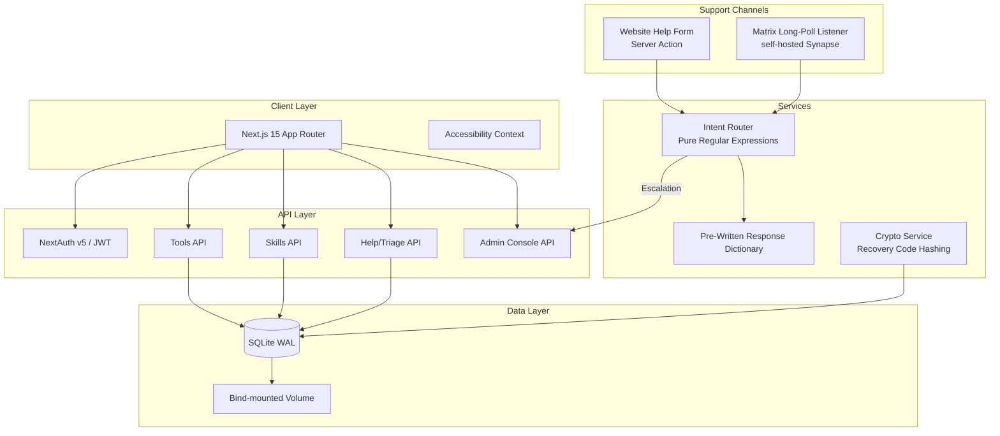
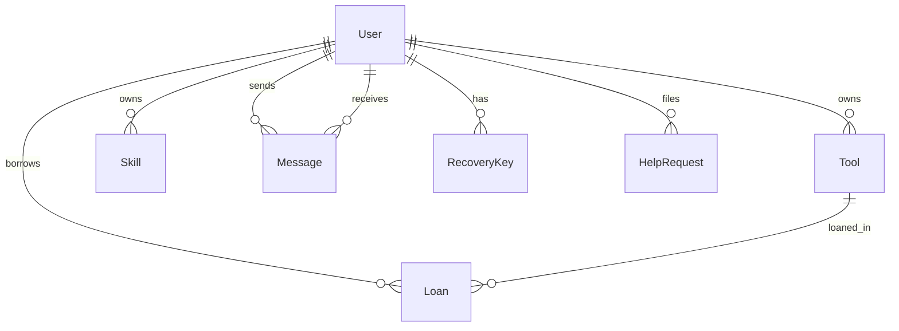

# ToolsLibrary Wiki
---

Documentation for the ToolsLibrary v2 codebase: a self-hosted, zero-PII platform for neighbor-to-neighbor tool lending and skills exchange. Built with Next.js 15, Prisma and SQLite, plus a strictly deterministic support and triage system — pure TypeScript and regular expressions with a fixed dictionary of pre-written replies.

[](https://nextjs.org/)
[](https://typescriptlang.org/)
[](https://prisma.io/)
[](https://tailwindcss.com/)
[](https://podman.io/)
[](/community-and-guidelines/license)
[](#core-design-principles)
[](https://fedoraproject.org/coreos/)
[-0066cc?logo=w3c&logoColor=white)](https://www.w3.org/TR/WCAG22/)

---

## Project Vision

The ToolsLibrary is a community-operated platform for lending tools and trading skills. It runs on hardware you control, keeps everything in one SQLite file, and collects no personally identifiable information. There is no tracking, no analytics, and no third-party service in the request path.

### Why This Exists

| Problem | Our Approach |
|---------|--------------|
| Tool libraries usually require signups with email or phone | Zero PII: an account is a username and a public alias |
| Cloud platforms harvest usage data | Local-first: a single SQLite file on your volume |
| "Smart" features quietly send data to third parties | Deterministic support: every automated reply is a fixed, reviewed string selected by plain regular expressions |
| Complex deployments need Kubernetes | One container: rootless Podman on Fedora CoreOS |

---

## Documentation Index

### Platform Overview

| Page | Description | Est. Read |
|------|-------------|-----------|
| [Project Overview](/platform-overview/project-overview) | Mission, tech stack, principles, repo structure, key flows | 5 min |
| [Core Features](/platform-overview/core-features) | Tool catalog, skills exchange, loan lifecycle, search/filter, trust scores | 8 min |

### System Architecture & Security

| Page | Description | Est. Read |
|------|-------------|-----------|
| [Architecture & Data Models](/system-architecture-and-security/architecture-and-data-models) | Prisma schema, ERD, all 7 models, indexes, enums | 10 min |
| [Authentication & Authorization](/system-architecture-and-security/authentication-and-authorization) | NextAuth v5, JWT sessions, route protection, registration, recovery | 8 min |
| [Security & Privacy](/system-architecture-and-security/security-and-privacy) | Zero-PII, secrets handling, deterministic support safety, validation, access control, hardening | 10 min |

### Platform Administration

| Page | Description | Est. Read |
|------|-------------|-----------|
| [Help System & Triage](/platform-administration/help-system-and-triage) | Regex intent router, pre-written responses, Matrix listener, escalation | 10 min |
| [Admin Console](/platform-administration/admin-console) | Terminal UI: telemetry, help queue, moderation, governance | 10 min |

### Infrastructure & Deployment

| Page | Description | Est. Read |
|------|-------------|-----------|
| [Deployment & Operations](/infrastructure-and-deployment/deployment-and-operations) | Rootless Podman on FCOS, Containerfile, deploy.sh, maintenance, backups | 10 min |

---

## System Architecture



### Core Design Principles

| Principle | Implementation |
|-----------|----------------|
| **Zero PII** | No emails, phones, IPs, or locations. An account is a `username` plus a public `alias` |
| **Local-first** | One SQLite file on a bind-mounted volume; no external database |
| **Deterministic support** | Replies come from a fixed, reviewed dictionary; routing is pure regex — no external services in the support path |
| **Accessibility by default** | WCAG 2.2 AAA targets: contrast modes, dyslexia-friendly font, reduced motion, reading guide |
| **No telemetry** | `NEXT_TELEMETRY_DISABLED=1`, no analytics, no request or IP logging |

**Accessibility status:** features targeting WCAG 2.2 Level AAA are implemented where feasible, and some WCAG 3.0 draft criteria are adopted. Automated checkers only cover part of the standard, so full compliance is not claimed. A manual audit is recommended before production use.

---

## Quick Start

### Local Development

```bash
# 1. Clone and enter
git clone <repository-url> toolslibrary-v2
cd toolslibrary-v2

# 2. Configure environment
cp .env.example .env
# Edit .env: set DATABASE_URL="file:./data/tool_library.db" and AUTH_SECRET

# 3. Install & initialize
npm install
npx prisma db push

# 4. Run development server
npm run dev
# → http://localhost:3000
```

### Production Deployment (Fedora CoreOS + Rootless Podman)

```bash
# On FCOS host
git clone <repository-url> /var/home/core/srv/tool-library
cd /var/home/core/srv/tool-library

# Optional: pin secrets across redeploys
export AUTH_SECRET="$(openssl rand -hex 32)"

# Deploy (idempotent)
./deploy.sh

# Verify
podman ps
curl -s http://localhost:3000
podman healthcheck run tool-library
```

**First admin:** the first account registered on an empty database receives the `ADMIN` role automatically.

---

## Key Concepts

| Concept | Summary | Deep Dive |
|---------|---------|-----------|
| **Zero-PII** | No emails, phones, or IPs. Only `username` and a public `alias` | [Project Overview](/platform-overview/project-overview), [Security & Privacy](/system-architecture-and-security/security-and-privacy) |
| **Intent router** | Priority-ordered regular expressions classify every help message | [Help System & Triage](/platform-administration/help-system-and-triage) |
| **Dual-channel support** | The website help form and the community Matrix server share one triage engine | [Help System & Triage](/platform-administration/help-system-and-triage) |
| **Trust score** | Base 100, displayed as `vouch = score - 100` (±N) | [Core Features](/platform-overview/core-features) |
| **Standalone build** | `output: 'standalone'` keeps the container small | [Deployment & Operations](/infrastructure-and-deployment/deployment-and-operations) |
| **SQLite WAL** | Single-file database, `PRAGMA journal_mode=WAL`, bind-mounted | [Architecture & Data Models](/system-architecture-and-security/architecture-and-data-models) |

---

## Development Commands

```bash
# Type safety
npm run typecheck          # tsc --noEmit (strict mode)

# Build
npm run build              # prisma generate + next build

# Runtime
npm run dev                # Development server with HMR
npm run start              # Production server (requires build first)

# Database
npx prisma studio          # Visual database browser
npx prisma db push         # Sync schema (dev)
npx prisma migrate dev     # Create migration (dev)
npx prisma generate        # Regenerate client

# Quality gates
node scripts/verify-handoff.mjs  # CI gate: checksum verification
```

---

## Repository Structure (Annotated)

```
toolslibrary-v2/
├── prisma/
│   └── schema.prisma          # Single source of truth for all data models
├── src/
│   ├── app/                   # Next.js 15 App Router
│   │   ├── api/
│   │   │   └── messages/      # Direct messaging between members
│   │   ├── admin/             # Admin Command Console
│   │   ├── tools/             # Tool catalog, detail, edit, create
│   │   ├── skills/            # Skills exchange, detail, edit, create
│   │   ├── help/              # Public support intake
│   │   ├── dashboard/         # Member dashboard
│   │   └── (auth pages)       # login, register, change-password, recover
│   ├── components/
│   │   ├── a11y/              # AccessibilityMenu, ReadingGuide
│   │   ├── layout/            # Navbar, Footer
│   │   ├── messenger/         # MessengerWidget (DMs)
│   │   └── ui/                # Shared primitives (Modal with focus trap)
│   ├── context/
│   │   └── AccessibilityContext.tsx  # Cross-session a11y prefs
│   ├── lib/
│   │   ├── actions/           # Server Actions (auth, tools, skills, help, websiteHelp, admin, messages)
│   │   ├── matrix.ts          # Matrix Client-Server API helper (native fetch)
│   │   ├── botResponses.ts    # Pre-written support responses (fixed strings)
│   │   ├── intentRouter.ts    # Regex intent router (priority-ordered)
│   │   ├── triageEngine.ts    # Central triage engine + escalation
│   │   ├── matrixListener.ts  # Matrix /sync long-polling listener
│   │   ├── crypto.ts          # Recovery code generation + hashing
│   │   ├── db.ts              # Prisma singleton (WAL pragmas)
│   │   └── constants.ts       # CATEGORIES, SKILL_CATEGORIES
│   ├── instrumentation.ts     # Boots the Matrix listener on server start
│   ├── auth.config.ts         # NextAuth config + callbacks
│   └── middleware.ts          # Force password change, route protection
├── wiki/                      # LeafWiki documentation source
├── tools-library-bot/         # Standalone deterministic Matrix helpdesk bot (separate npm project)
├── Containerfile              # Multi-stage rootless Podman image
├── deploy.sh                  # Idempotent FCOS deployment wrapper
├── .dockerignore              # Excludes secrets, runtime data, build artifacts
├── next.config.ts             # output: 'standalone'
├── package.json
├── tsconfig.json
├── DEPLOYMENT.md
├── CLEANUP_REPORT.md
└── AGENTS.md                  # Development operating contract
```

---

## Data Model Overview



### Core Entities

| Entity | Purpose | Key Fields |
|--------|---------|------------|
| **User** | Community member | `username`, `alias`, `role`, `trustScore`, `banned` |
| **Tool** | Lendable item | `name`, `category`, `status` (AVAILABLE/BORROWED/MAINTENANCE) |
| **Skill** | Offered expertise | `name`, `category`, `available` (OFFERED/PAUSED) |
| **Loan** | Borrowing lifecycle | `status`, `startDate`, `endDate`, `returnCondition` |
| **HelpRequest** | Support ticket | `category` (detected intent), `urgency`, `route`, `status` |

---

## Security Highlights

| Layer | Mechanism |
|-------|-----------|
| **Auth** | bcrypt cost 12, JWT HS256, 1h sliding expiry, CSRF protection |
| **Recovery** | 8 single-use recovery codes, SHA-256 hashed at rest |
| **Support** | Deterministic triage: fixed replies, regex routing, escalation to the admin team room |
| **Validation** | Zod schemas on all inputs (API routes, forms, Server Actions) |
| **Container** | Rootless Podman, `--userns=keep-id`, SELinux `:Z`, non-root user |

---

## Quality Assurance

- **Zero-stub tolerance**: no `TODO`, `FIXME`, or `throw "Not implemented"` in `src/`
- **Strict TypeScript**: `tsc --noEmit` passes with no errors
- **Schema-driven**: Prisma is the single source of truth; Zod mirrors it for runtime validation
- **Checksum verification**: `verify-handoff.mjs` checks repo integrity between sessions
- **No runtime external dependencies**: everything bundles into the standalone build

---

## External References

| Technology | Documentation |
|------------|---------------|
| Next.js 15 | <https://nextjs.org/docs> |
| Prisma 5 | <https://www.prisma.io/docs> |
| NextAuth v5 | <https://authjs.dev> |
| Tailwind CSS v4 | <https://tailwindcss.com> |
| Zod | <https://zod.dev> |
| Matrix Client-Server API | <https://matrix.org/docs/> |
| Podman Rootless | <https://rootlesscontaine.rs/getting-started/podman/> |
| Fedora CoreOS | <https://fedoraproject.org/coreos/> |
| SQLite WAL Mode | <https://sqlite.org/wal.html> |

---

## Contributing

See [`CONTRIBUTING.md`](/community-and-guidelines/contributing) on the wiki, or the copy in the repository root:

1. Fork, branch, and open a PR with a descriptive title
2. TypeScript strict mode: no `any`, no implicit returns
3. Zod validation on all inputs (API routes, Server Actions)
4. Zero-stub tolerance: no `TODO`, `FIXME`, or placeholder implementations
5. Update the relevant wiki page(s) when behavior changes
6. Run the quality gates: `npm run typecheck`, `npm run build`, `node scripts/verify-handoff.mjs`

---

## License

**AGPL-3.0-only**. See the `Containerfile` OCI labels and the license file in the repository root.

The license requires that anyone who modifies this software and offers it as a network service must provide the corresponding source code to their users. That protects the community's right to self-host and audit the platform they depend on.

---

> This wiki describes the implementation in `toolslibrary-v2/` as of October 2026. Run `node scripts/verify-handoff.mjs` to confirm repository integrity.
