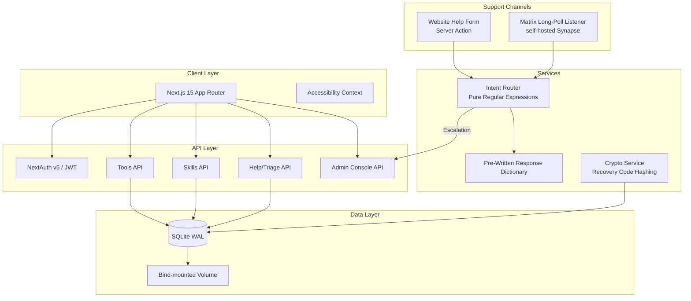
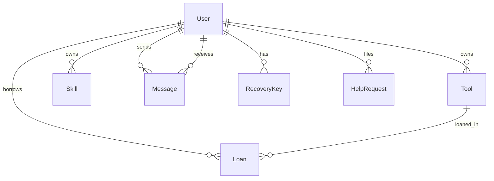

# Tool Library Wiki

> **Complete documentation for the Tool Library v2 codebase** — a zero-PII, self-hosted community tool lending and skills exchange platform built with Next.js 15, Prisma/SQLite, and a strictly deterministic support and triage system (pure TypeScript + Regular Expressions, no external services).

[](https://nextjs.org/)
[](https://typescriptlang.org/)
[](https://prisma.io/)
[](https://tailwindcss.com/)
[](https://podman.io/)
[](LICENSE)
[](#-zero-pii-commitment)

---

## 🎯 Project Vision

The Tool Library is a **privacy-first, community-operated platform** for neighbor-to-neighbor tool lending and skill sharing. Designed for communities that value data sovereignty, it runs entirely on your hardware with zero external dependencies, zero tracking, and zero personally identifiable information.

### Why This Exists

| Problem | Our Approach |
|---------|--------------|
| Tool libraries require signups with email/phone | **Zero PII** — only a username and public alias |
| Cloud platforms harvest usage data | **Local-first** — single SQLite file on your volume |
| "Smart" features send data to third parties | **Deterministic by design** — every automated reply is a pre-written, reviewed string selected by plain regular expressions |
| Complex deployments need Kubernetes | **Single binary** — rootless Podman on Fedora CoreOS |

---

## 📖 Documentation Index

The full documentation lives in the [`wiki/`](wiki/) directory (LeafWiki source):

| Page | Description | Est. Read |
|------|-------------|-----------|
| [Project Overview](wiki/Platform%20Overview/Project-Overview.md) | Mission, tech stack, principles, repo structure, key flows | 5 min |
| [Architecture & Data Models](wiki/System%20Architecture%20&%20Security/Architecture-Data-Models.md) | Prisma schema, ERD, all models, indexes, enums | 10 min |
| [Authentication & Authorization](wiki/System%20Architecture%20&%20Security/Auth-Authorization.md) | NextAuth v5, JWT sessions, route protection, registration, recovery | 8 min |
| [Core Features: Tools, Skills, Loans](wiki/Platform%20Overview/Core-Features.md) | Tool catalog, skills exchange, loan lifecycle, search/filter, trust scores | 8 min |
| [Help System & Triage](wiki/Platform%20Administration/Help-System-Triage.md) | Regex intent router, pre-written responses, Matrix listener, escalation | 10 min |
| [Admin Console](wiki/Platform%20Administration/Admin-Console.md) | Terminal UI: telemetry, help queue, moderation, governance | 10 min |
| [Deployment & Operations](wiki/Infrastructure%20&%20Deployment/Deployment-Operations.md) | Rootless Podman on FCOS, Containerfile, deploy.sh, maintenance, backups | 10 min |
| [Security & Privacy](wiki/System%20Architecture%20&%20Security/Security-Privacy.md) | Zero-PII, validation, access control, hardening | 10 min |

---

## 🏗️ System Architecture



### Core Design Principles

| Principle | Implementation |
|-----------|----------------|
| **Zero PII** | No emails, phones, IPs, locations — only `username` + public `alias` |
| **Local-first** | Single SQLite file on bind-mounted volume; no external DB |
| **Deterministic support** | Replies come from a fixed, reviewed dictionary; routing is pure regex — no external services in the support path |
| **Accessibility by default** | WCAG 2.1 AA contrast, dyslexic font, reduced motion, reading guide |
| **No telemetry** | `NEXT_TELEMETRY_DISABLED=1`, no analytics, no request/IP logging |

---

## 🚀 Quick Start

### Local Development

```bash
# 1. Clone and enter
git clone <repository-url> toolslibrary-v2
cd toolslibrary-v2

# 2. Configure environment
cp .env.example .env
# Edit .env: set DATABASE_URL="file:./data/tool_library.db" and AUTH_SECRET
# 3. Install & initialize

npm install

npx prisma migrate dev
# 4. Run development server
npm run dev
# → http://localhost:3000
```

### Production Deployment (Fedora CoreOS + Rootless Podman)

```bash
# On FCOS host
git clone <repository-url> /var/home/core/srv/tool-library
cd /var/home/core/srv/tool-library

# Optional: pin secrets across redeploys
export AUTH_SECRET="$(openssl rand -hex 32)"

# Deploy (idempotent)
./deploy.sh

# Verify
podman ps
curl -s http://localhost:3000
podman healthcheck run tool-library
```

**First admin:** The first account registered on an empty database automatically receives the `ADMIN` role.

---

## 🔑 Key Concepts

| Concept | Summary | Deep Dive |
|---------|---------|-----------|
| **Zero-PII** | No emails, phones, IPs — only `username` + public `alias` | [Project Overview](wiki/Platform%20Overview/Project-Overview.md), [Security & Privacy](wiki/System%20Architecture%20&%20Security/Security-Privacy.md) |
| **Intent Router** | Priority-ordered regular expressions classify every help message | [Help System & Triage](wiki/Platform%20Administration/Help-System-Triage.md) |
| **Dual-Channel Support** | The website help form and the community Matrix server share one triage engine | [Help System & Triage](wiki/Platform%20Administration/Help-System-Triage.md) |
| **Trust Score** | Base 100, displayed as `vouch = score - 100` (±N) | [Core Features](wiki/Platform%20Overview/Core-Features.md) |
| **Standalone Build** | `output: 'standalone'` for minimal container footprint | [Deployment & Operations](wiki/Infrastructure%20&%20Deployment/Deployment-Operations.md) |
| **SQLite WAL** | Single-file DB, `PRAGMA journal_mode=WAL`, bind-mounted | [Architecture & Data Models](wiki/System%20Architecture%20&%20Security/Architecture-Data-Models.md) |

---

## 🛠️ Development Commands

```bash
# ─── Type Safety ───
npm run typecheck          # tsc --noEmit (strict mode)

# ─── Build ───
npm run build              # prisma generate + next build

# ─── Runtime ───
npm run dev                # Development server with HMR
npm run start              # Production server (requires build first)

# ─── Database ───
npx prisma studio          # Visual database browser
npx prisma migrate deploy  # Apply committed migrations (production boot path)
npx prisma migrate dev     # Create migration (dev)
npx prisma generate        # Regenerate client

# ─── Quality Gates ───
node scripts/verify-handoff.mjs  # CI gate: checksum verification
```

---

## 📁 Repository Structure (Annotated)

```
toolslibrary-v2/
├── prisma/
│   └── schema.prisma          # ← Single source of truth for all data models
├── src/
│   ├── app/                   # Next.js 15 App Router
│   │   ├── api/
│   │   │   └── messages/      # Direct messaging between members
│   │   ├── admin/             # Admin Command Console (terminal aesthetic)
│   │   ├── tools/             # Tool catalog, detail, edit, create
│   │   ├── skills/            # Skills exchange, detail, edit, create
│   │   ├── help/              # Public support intake form
│   │   ├── dashboard/         # Member dashboard
│   │   └── (auth pages)       # login, register, change-password, recover
│   ├── components/
│   │   ├── a11y/              # AccessibilityMenu, ReadingGuide
│   │   ├── layout/            # Navbar, Footer
│   │   └── messenger/         # MessengerWidget (DMs)
│   ├── context/
│   │   └── AccessibilityContext.tsx  # Cross-session a11y prefs
│   ├── lib/
│   │   ├── actions/           # Server Actions (auth, tools, skills, help, websiteHelp, admin, messages)
│   │   ├── matrix.ts          # Matrix Client-Server API helper (native fetch)
│   │   ├── botResponses.ts    # Pre-written support responses (fixed strings)
│   │   ├── intentRouter.ts    # Regex intent router (priority-ordered)
│   │   ├── triageEngine.ts    # Central triage engine + escalation
│   │   ├── matrixListener.ts  # Matrix /sync long-polling listener
│   │   ├── crypto.ts          # Recovery code generation + hashing
│   │   ├── db.ts              # Prisma singleton (WAL pragmas)
│   │   └── constants.ts       # CATEGORIES, SKILL_CATEGORIES
│   ├── instrumentation.ts     # Boots the Matrix listener on server start
│   ├── auth.config.ts         # NextAuth config + callbacks
│   └── middleware.ts          # Force password change, route protection
├── wiki/                      # LeafWiki documentation source
├── tools-library-bot/         # Standalone deterministic Matrix helpdesk bot (separate npm project)
├── Containerfile              # Multi-stage rootless Podman image
├── deploy.sh                  # Idempotent FCOS deployment wrapper
├── .dockerignore              # Excludes secrets, runtime data, build artifacts
├── next.config.ts             # output: 'standalone'
├── package.json
├── tsconfig.json
├── DEPLOYMENT.md
├── CLEANUP_REPORT.md
└── AGENTS.md                  # Development operating contract
```

---

## 🗄️ Data Model Overview



### Core Entities

| Entity | Purpose | Key Fields |
|--------|---------|------------|
| **User** | Community member | `username`, `alias`, `role`, `trustScore`, `banned` |
| **Tool** | Lendable item | `name`, `category`, `status` (AVAILABLE/BORROWED/MAINTENANCE) |
| **Skill** | Offered expertise | `name`, `category`, `available` (OFFERED/PAUSED) |
| **Loan** | Borrowing lifecycle | `status`, `startDate`, `endDate`, `returnCondition` |
| **HelpRequest** | Support ticket | `category` (detected intent), `urgency`, `route`, `status` |

---

## 🛡️ Security Highlights

| Layer | Mechanism |
|-------|-----------|
| **Auth** | bcrypt cost 12, JWT HS256, 1h sliding expiry, CSRF protection |
| **Recovery** | 8 single-use recovery codes, SHA-256 hashed at rest |
| **Support** | Deterministic triage: fixed replies, regex routing, escalation to the admin team room |
| **Validation** | Zod schemas on all inputs (API routes, forms, Server Actions) |
| **Container** | Rootless Podman, `--userns=keep-id`, SELinux `:Z`, non-root user |

---

## 🧪 Quality Assurance

- **Zero-stub tolerance**: No `TODO`, `FIXME`, or `throw "Not implemented"` in `src/`
- **Strict TypeScript**: `tsc --noEmit` passes with no errors
- **Schema-driven**: Prisma as single source of truth; Zod mirrors for runtime validation
- **Checksum verification**: `verify-handoff.mjs` ensures repo integrity across sessions
- **No external deps at runtime**: All code bundles into the standalone build

---

## 🔗 External References

| Technology | Documentation |
|------------|---------------|
| Next.js 15 | <https://nextjs.org/docs> |
| Prisma 5 | <https://www.prisma.io/docs> |
| NextAuth v5 | <https://authjs.dev> |
| Tailwind CSS v4 | <https://tailwindcss.com> |
| Zod | <https://zod.dev> |
| Matrix Client-Server API | <https://matrix.org/docs/> |
| Podman Rootless | <https://rootlesscontaine.rs/getting-started/podman/> |
| Fedora CoreOS | <https://fedoraproject.org/coreos/> |
| SQLite WAL Mode | <https://sqlite.org/wal.html> |

---

## 🤝 Contributing

See [`CONTRIBUTING.md`](wiki/Community%20and%20Guidelines/CONTRIBUTING.md) on the wiki, or the copy in the repository root:

1. **Fork → Branch → PR** with descriptive title
2. **TypeScript strict mode** — no `any`, no implicit returns
3. **Zod validation** on all inputs (API routes, Server Actions)
4. **Zero-stub tolerance** — no `TODO`, `FIXME`, placeholder implementations
5. **Update relevant wiki page(s)** — documentation lives in `wiki/`
6. **Run quality gates** — `npm run typecheck`, `npm run build`, `node scripts/verify-handoff.mjs`

---

## 📄 License

**AGPL-3.0-only** — see `Containerfile` OCI labels and repository root.

This license ensures that if you modify and deploy this software as a network service, you must offer the corresponding source code to your users. It protects the community's right to self-host and audit the platform they depend on.

---

> **Generated from codebase analysis** — This wiki reflects the actual implementation in `toolslibrary-v2/` as of 2026. Run `node scripts/verify-handoff.mjs` to verify integrity.
